# Palash More

  

  
  
  
  

<em>
Software Developer building enterprise-grade systems that serve Tier-1 automotive OEMs. 
5+ years shipping .NET backends, SQL databases, and event-driven architectures 
across 5+ concurrent product lines — and consistently writing clean, maintainable code on all of them. 
Specialized in high-concurrency microservices, SQL query tuning, and Kafka event streaming.
</em>

---

Software Developer with **5+ years of experience (July 2021 — Present)** at **Excellon Software Pvt. Ltd., Nagpur, India**.

I architect, build, and optimize high-concurrency Web & Windows applications using **.NET Core, C#, ASP.NET MVC, Entity Framework Core, gRPC, and SQL Server**. Across 5+ concurrent product lines, I develop core platforms for Tier-1 automotive OEMs including **Ford, Bajaj, TVS, Altigreen, Lectrix, Matter, CLPL, and Moto Drive**.

enterprise engineering 
﹂**Software Developer @ [Excellon Software Pvt. Ltd.](https://www.aborad.com/)** — Nagpur, India 
&nbsp;&nbsp;&nbsp;&nbsp;﹂July 2021 — Present (5+ years) 
&nbsp;&nbsp;&nbsp;&nbsp;﹂building Dealer Management Systems (DMS) for Ford, Bajaj, TVS, Altigreen, Lectrix, Matter 
&nbsp;&nbsp;&nbsp;&nbsp;﹂event-driven microservices · Kafka · gRPC · WhatsApp Business API integrations 
&nbsp;&nbsp;&nbsp;&nbsp;﹂reduced page load times by 50% through SQL query optimization and backend refactoring 
&nbsp;&nbsp;&nbsp;&nbsp;﹂99% bug-free module delivery rate across releases 
﹂**Multitasker & Extra Mile Award** winner — delivering across 5+ simultaneous product tracks

---

 

| Recognition / Milestone | Technical Scope & Business Impact |
|:---|:---|
| 🏆 **Multitasker & Extra Mile Award** | Awarded at Excellon Software for successfully orchestrating and delivering across 5+ concurrent product tracks ahead of deadline without compromising software quality. |
| ⚡ **50% Application Load Speedup** | Diagnosed complex performance bottlenecks, optimized SQL Server stored procedures, analyzed execution plans, and refactored caching strategies. |
| 🛡️ **99% Bug-Free Module Delivery** | Sustained high quality across enterprise releases through comprehensive unit testing, automated verification, and thorough architectural peer reviews. |
| ⚙️ **90% Manual Operations Saved** | Engineered end-to-end event automation pipelines connecting transactional databases to Kafka event streams and automated WhatsApp Business API customer notifications. |
| 🚗 **Tier-1 Automotive OEM Scope** | Delivered mission-critical CDMS, sales pipelines, and EV telemetry platforms for **Ford, Bajaj, TVS, Altigreen, Lectrix, Matter, CLPL, and Moto Drive**. |
| 🎓 **Academic Excellence (8.13 CGPA)** | BE in Computer Engineering, Bapurao Deshmukh College of Engineering, Sewagram (2017–2021). |

---

  
  
  

  
  

<table>
  <tr>
    <td width="50%" valign="top">
      <a href="https://github.com/palashmore/home-expence"><b>Home Expense</b></a> 
      Multi-household financial management system with staff payroll, notifications, RBAC, and 450+ audit checks 
       
      scrypt auth · push notifications · durable sync via GitHub Gist · 9 test suites
        
      
      
    </td>
    <td width="50%" valign="top">
      <a href="https://github.com/palashmore/kafkaConsumerProject"><b>Kafka Consumer Project</b></a> 
      Kafka event stream consumer implementation for decoupled microservice integration 
       
      Topic-based message ingestion · JSON payload serialization · consumer group partition handling
        
      
    </td>
  </tr>
</table>

Other repositories: <a href="https://github.com/palashmore/Palash-portfolio-">Palash-portfolio-</a> (executive portfolio website) · <a href="https://github.com/palashmore/homeexpenses">homeexpenses</a> · <a href="https://github.com/palashmore/palashproject.github.io">palashproject.github.io</a>

---

<table>
  <tr>
    <td width="50%" valign="top">
      <strong>Languages & Core Frameworks</strong>  
      
      
      
      
      
      
    </td>
    <td width="50%" valign="top">
      <strong>Backend & API Architecture</strong>  
      
      
      
      
      
    </td>
  </tr>
  <tr>
    <td width="50%" valign="top">
      <strong>Frontend & UI Engineering</strong>  
      
      
      
      
    </td>
    <td width="50%" valign="top">
      <strong>Databases & Distributed Caching</strong>  
      
      
      
      
    </td>
  </tr>
  <tr>
    <td width="50%" valign="top">
      <strong>Messaging & Third-Party Integration</strong>  
      
      
    </td>
    <td width="50%" valign="top">
      <strong>Cloud, DevOps & Tooling</strong>  
      
      
      
      
      
    </td>
  </tr>
</table>

---

### Education & Professional Experience

**Software Developer** — [Excellon Software Pvt. Ltd.](https://www.aborad.com/), Nagpur, India *(July 2021 — Present)* 
🎓 **BE in Computer Engineering** — Bapurao Deshmukh College of Engineering, Sewagram *(CGPA: 8.13 / 10)* 
📜 **Certifications**: JavaScript Ultimate (Udemy 2025) · Google Cloud Computing (IIT Bombay 2020) · Python (Udemy 2019)

---

### Activity & Telemetry

  
  &nbsp;&nbsp;
  

---

  
  
  
  

 

---
